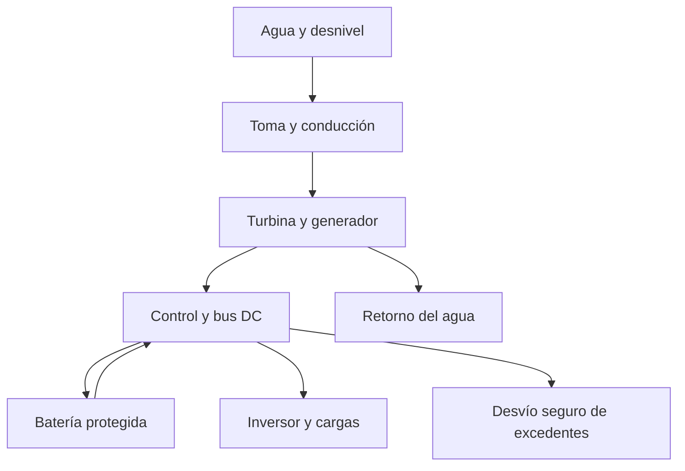

# Guía de microhidráulica: del recurso al piloto

Versión 0.1 • 2026-10-15 • Opción prioritaria de investigación, todavía no seleccionada para instalar.

## Objetivo, física y fronteras

**demostrado:** el agua descendente puede entregar trabajo mecánico y electricidad. El recurso es su energía gravitacional, renovada por el ciclo hidrológico. [DOE/NREL, Small Hydropower Systems, julio de 2001](https://docs.nlr.gov/docs/fy01osti/29065.pdf).

**estimación propia:** `P_DC(W) = 9,81 × Q(L/s) × H_neta(m) × eta`. Aquí eta incluye turbina, transmisión si existe, generador, rectificación y cable hasta el bus DC. No incluye inversor ni batería. `H_neta = H_bruta − pérdidas hidráulicas`. No descontar la tubería de nuevo dentro de eta.

Es un diagrama funcional; no especifica cableado. El paso del agua por la turbina termina en el retorno.

## Fase 0: medir antes de elegir rotor

Completar caudal de estiaje aprovechable, altura bruta, longitud y trazado de conducción, variaciones de caudal, calidad de agua, distancia eléctrica y acceso legal. Medir altura vertical con nivelación, no con longitud de manguera. Confirmar estabilidad de toma y retorno frente a crecientes con especialista.

Ejemplo: Q=2 L/s, H_neta=12 m, eta=0,60 → **141,3 W DC**. Si estuviera disponible 24 h, **3,39 kWh DC/día**. Tras eta inversor=0,92 serían como máximo 3,12 kWh AC si todo pasara directamente, antes de auxiliares y pérdidas de almacenamiento. Nuestro consumo supuesto exige 3,110 kWh/día al bus, antes de pérdidas de batería; queda poco margen con hidráulica sola.

El tamaño comercial en kW no sustituye la curva de la máquina a tus Q y H. Para salto bajo y gran caudal puede corresponder otra familia de turbina; no elegir Pelton solo por facilidad de fabricación. Una bomba usada como turbina requiere caracterización y regulación; su reversibilidad no asegura buena eficiencia.

## Fase 1: banco abierto de energía pequeña

**Objetivo:** medir potencia en una resistencia y demostrar que depende de caudal y altura. No validar con ello una turbina de vivienda.

| Componente | Cantidad y especificación | Recuperación / verificación | Provisión USD |
|---|---|---|---:|
| Depósito abierto | 1, 2–5 L, apoyo estable sobre mesa; diferencia de altura ≤0,7 m | Recipiente limpio no quebradizo; no recipiente de químicos | 0–5 |
| Manguera flexible y pinza de regulación | 1 tramo corto, descarga libre, sin presión de red | Revisar grietas; no circuito sellado | 3–8 |
| Turbina educativa pequeña o rueda protegida | 1, potencia de banco <2 W | Rejilla/carcasa evita contacto; no aspas metálicas expuestas | 5–15 |
| Motor DC de imanes permanentes como generador | 1, referencia nominal 3–6 V, eje sin juego | Ensayar giro suave; no asumir que motor de impresora es apto sin identificarlo | 0–10 |
| Resistencias | 10, 47 y 100 ohmios, 5 W cada una | Medir resistencia en frío, tolerancia preferible 1% | 2–5 |
| Cables y protección | 1 juego; circuito ≤12 V, limitado por recurso; fusible acorde si hay fuente auxiliar | Sin batería en esta primera prueba | 3–7 |
| Medición | Multímetro en V DC, jarra, reloj, cinta | Instrumentos comunes de `02` | Reutilizados |

Total de piezas: **USD 13–50 estimados**, instrumentos aparte. Si el motor, recipiente, resistencia y herramientas ya existen, el desembolso puede ser cero. Material recuperado debe probarse antes de contar con él.

Procedimiento:

1. Fijar el generador y proteger la rueda en una bandeja. Mantener terminales y multímetro secos, separados de salpicaduras.
2. Colocar el pequeño depósito en apoyo sólido; recoger toda el agua abajo. No apilar recipientes ni conectar a la red de agua presurizada.
3. Medir masa/volumen disponible, altura media de caída, resistencia y tiempo. Al bajar el nivel del depósito, también cambia la altura: registrar inicio/final o mantener una pequeña alimentación gravitacional conocida.
4. Conectar una resistencia de 100 ohmios a los terminales del generador y el voltímetro en paralelo con ella, en modo voltaje. Abrir un caudal pequeño; parar si hay vibración, salpicaduras sobre electricidad o más de 12 V.
5. Registrar V cada 1–2 s o mediante vídeo de la pantalla y reloj; `P_salida = V²/R`. Esta forma evita poner el multímetro en modo corriente. Si la tensión varía muy rápido o es pulsante, este método con una lectura promediada puede subestimar; se necesita adquisición apropiada.
6. Cerrar flujo, esperar parada y cambiar a 47 ohmios; repetir, luego 10 ohmios. No tocar partes girando. Mantener igual caudal/altura al comparar; repetir tres veces cada carga.
7. Integrar Wh de salida y calcular `E_hidráulica = masa × g × altura_media / 3600` en Wh. Si el dato de altura es incompleto, no publicar rendimiento.

Con 5 L y 0,7 m, el máximo gravitacional es **0,00954 Wh**, antes de pérdidas. Por eso el ensayo dura poco y no demuestra carga útil de una batería grande. El cálculo adicional de 20 L a 1 m del script (0,0545 Wh) es solo una referencia de escala, no una instrucción para elevar ese peso.

**Aceptación propuesta:** potencia bajo carga claramente por encima de resolución, repetición dentro del 15% con entradas equivalentes y salida menor que entrada dentro de incertidumbre. No exigir un rendimiento predeterminado a material recuperado. Si aparenta superar 100%, revisar volumen, altura, tiempo, calibración y energía externa.

## Fase 2: prototipo instrumentado en recurso real

Tras evaluación del sitio y autorización: escoger módulo de 20–100 W o el menor compatible con Q/H; sistema DC y carga resistiva adecuada, controlador de desvío y parada diseñados para ese generador. Un motor de laboratorio no se escala por multiplicación geométrica.

Medir simultáneamente Q, presión/altura neta, RPM si se dispone, V/I y temperatura del generador durante 2 h a varios puntos de carga, luego 7 días con registro. La construcción de captación, conducción presurizada y montaje en el cauce queda a diseño profesional. El prototipo no se conecta a la casa.

Puntos de medida: entrada de conducción, entrada de turbina, salida del rectificador, bus de batería y carga. Registrar pérdida de conducción por separado. El BMS puede desconectar la batería: el sistema hidráulico debe mantener control de velocidad y sobretensión aun en esa situación. No basta con un controlador solar genérico.

Criterio propuesto de avance: curva potencia/caudal reproducible, balance explicado dentro de ±15%, funcionamiento dentro de temperaturas de fabricante, parada y exceso de generación resueltos, y no más de una intervención correctiva no planificada en siete días. Es una meta de laboratorio, no certificación.

## El diámetro de conducción puede decidir la viabilidad

**Estimación ejecutada** por Darcy–Weisbach, 100 m, Q=2 L/s, salto bruto 15 m, factor de fricción supuesto f=0,025 y suma de pérdidas menores K=3:

| Diámetro INTERIOR | Pérdida total | Altura neta calculada | Potencia DC a eta=0,60 |
|---|---:|---:|---:|
| 32 mm | 25,57 m | Negativa a ese caudal | Ese caudal es incompatible; no existe potencia negativa física |
| 50 mm | 2,80 m | 12,20 m | 143,6 W |
| 63 mm | 0,90 m | 14,10 m | 166,0 W |

No equivale a una selección de tubería: f depende de Reynolds/rugosidad, y el diámetro nominal no es el interior. Presión estática, golpe de ariete, anclajes, temperatura y sobrepresiones requieren cálculo. Mejorar de 50 a 63 mm aportaría unos 22,5 W en este caso a caudal fijo; debe compararse con el costo adicional y disponibilidad real de agua.

## Fase 3: piloto de carga real

Primero una carga prescindible (luz o comunicaciones) durante 30 días, con respaldo. Evaluar después nevera/computador por circuitos instalados correctamente. Requisitos para el piloto: medición AC, protección DC/AC, batería documentada si la necesita, control de excedentes, parada segura y registro de servicio. Ensayar desconexión de carga y recuperación tras una parada mediante procedimiento del fabricante, con instalador.

Criterios: Wh útiles, horas de déficit, causas de parada, tiempo de mantenimiento y consumo auxiliar. Para refrigeración, mantener respaldo y verificar el servicio térmico; no convertir los alimentos en un experimento de autonomía.

## Fases 4–6: vivienda y finca

Solicitar propuesta con curva de turbina para caudal mínimo y máximo, rendimiento hasta DC, pérdidas de cable, máximo voltaje en vacío/embalamiento, desvío, compatibilidad de reguladores y protección independiente. La arquitectura común y componentes están en `04`; el presupuesto adicional en `06`.

Para ampliar, aumentar el recurso legal y físicamente disponible o mejorar eficiencia demostrada. Dos turbinas sobre la misma caída no duplican la energía si reparten el mismo caudal. Dos escalones en cascada solo aprovechan alturas diferentes reales. Si se usa el mismo agua para riego/ariete, contabilizar caudales y retornos sin doble uso simultáneo ficticio.

Espacio: corredor de conducción, captación, retorno y caseta seca; los metros cuadrados no se pueden estimar sin plano. Puede impedir ampliación el estiaje, caudal ambiental, terreno inestable, largos cables, erosión o costo de obra.

## Fase 7: fallos y mantenimiento

| Síntoma | Diagnóstico a registrar | Acción / decisión |
|---|---|---|
| Menos W con igual nivel de fuente | Q, pérdida de carga, filtro, sedimentos, aire, tensión | Limpiar siguiendo parada segura; comparar antes/después |
| Vibración o ruido nuevo | RPM, rodamientos, alineación, objetos | Parar y revisar; no seguir hasta falla destructiva |
| Tensión excesiva al perder carga | Estado de desvío, controlador, BMS | Inhabilitar piloto y corregir diseño de protección |
| Generación estable pero pocos Wh AC | Auxiliares, batería, pérdidas de cable, inversor | Medir fronteras separadas, no culpar solo a turbina |
| Mantenimiento frecuente de toma | Horas-persona, frecuencia y causa | Rediseñar acceso/filtrado o reconsiderar viabilidad |

Revisar toma desde acceso seguro según acumulación y después de eventos, nunca durante creciente; inspección mecánica mensual inicial y frecuencia posterior basada en resultados. Usar lubricante e intervalos del fabricante. Conservar repuestos de sellos, rodamientos identificados y fusibles. La documentación comercial actual de [PowerSpout](https://www.powerspout.com/pages/document-index) incluye manuales y guías de compatibilidad; su existencia no valida nuestro escenario ni el uso de un modelo concreto a 12 m.
