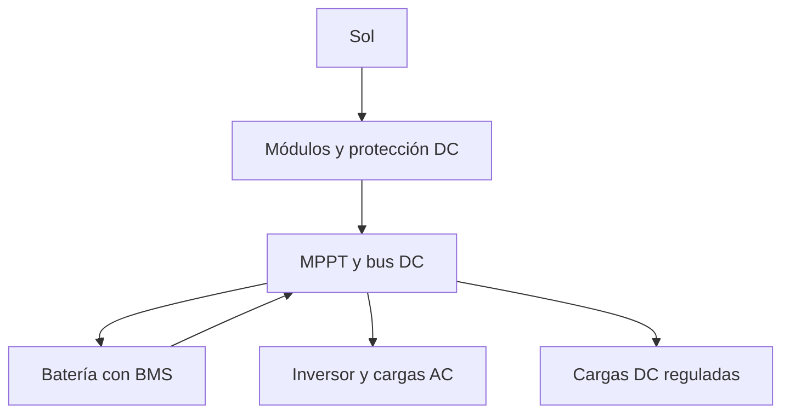

# Guía solar fotovoltaica

Versión 0.1 • 2026-10-15 • Alternativa principal o complemento por decidir con mediciones.

## Objetivo y balance

**demostrado:** los módulos convierten radiación en electricidad. **estimación:** `E_DC = kWp × HSP × factor_hasta_bus`. HSP son horas equivalentes a 1 kW/m² de irradiación en el plano; no duración del día. Para 0,8 kWp, 4 HSP y factor 0,80: 2,56 kWh DC/día. En el modelo el factor ya incluye temperatura, suciedad, regulador y cable hasta bus; inversor y batería se contabilizan después.

Para el pronóstico por ubicación usar [PVGIS, JRC](https://joint-research-centre.ec.europa.eu/photovoltaic-geographical-information-system-pvgis_en), con serie horaria y sombras propias. Aún no se ha calculado producción local. Orientación, inclinación y régimen de lluvias dependen del sitio; no copiar sin adaptación orientación recomendada para Estados Unidos.

## Fases 0–1: prueba sin batería

Objetivo: medir 0,1–2 W bajo carga en un módulo pequeño y observar sombras y orientación. Materiales presupuestados en USD a 2026-10-15, estimaciones minoristas internacionales, instrumentos comunes aparte:

| Pieza | Cantidad y especificación | Provisión |
|---|---|---:|
| Módulo educativo | 1 de 6 V nominales y 1–3 W, Voc documentado <12 V | USD 5–15 |
| Resistencias | 22, 47 y 100 ohmios, 5 W; usar una por ensayo | USD 3–6 |
| Cables, soporte y protección | 1 juego aislado, soporte a nivel de suelo | USD 3–10 |
| Voltímetro y reloj | 1 de cada, multímetro en modo voltaje | Reutilizados |

1. Verificar placa, cables, encapsulado y polaridad; recuperar un panel de lámpara solo si se puede aislar de su batería sin manipular celdas dañadas y documentar sus límites.
2. Con panel cubierto, conectar 100 ohmios y voltímetro en paralelo. Descubrir y orientar sin mirar reflejos intensos. No unir paneles en serie.
3. Registrar V, hora, nubosidad y orientación. Calcular `P=V²/R`. Repetir con 47 y 22 ohmios, cubriendo antes de cambiar; detener si la resistencia se calienta fuera de su especificación.
4. Comparar posiciones alternadas cada 1–2 minutos, porque una nube puede falsear una comparación hecha una hora después. Hacer al menos tres repeticiones en tres días.
5. Integrar energía solo sobre el tiempo realmente observado. Medir Voc puede ayudar a diagnosticar pero no sustituye potencia con resistencia.

Aceptación: potencia reproducible con condiciones comparables y efecto de sombra mayor que incertidumbre. No inferir eficiencia sin irradiancia y área; tampoco potencia máxima a partir de una única resistencia. El barrido discreto solo aproxima una curva de carga.

## Fase 2: módulo instrumentado de 20–100 W

Pasar a panel con ficha, regulador compatible, carga DC conocida y, si procede, batería comercial protegida con instrucciones completas. El cableado y fusibles deben corresponder al máximo Voc en frío, Isc, longitud, corriente de carga y capacidad de interrupción DC. Un fusible no convierte una batería de alta energía en un banco de bajo riesgo.

BOM conceptual para piloto de 100 W: 1 panel 100 W, 1 regulador de 10–15 A apto para sus tensiones, 1 batería comercial de 12,8 V y 20 Ah con BMS compatible, 1 corte de descarga, 1 carga LED DC de 5–10 W, cableado/protecciones/envolvente y 1 medidor Wh. Provisión **USD 220–450**, sin instrumentos comunes ni instalación fija. No comprar hasta verificar tensiones reales y límites; 12 V es denominación nominal, no tensión constante.

El orden de conexión lo define el manual exacto. Como ejemplo documentado, [Victron SmartSolar: instalación](https://www.victronenergy.com/media/pg/Manual_SmartSolar_MPPT_75-10_up_to_100-20/es/installation.html) requiere configurar y verificar correctamente la detección de batería; no extrapolar un procedimiento a otro controlador. Este paquete no da un esquema de potencia universal.

Registrar 7–14 días de Wh en panel/regulador/carga, SOC inicial/final, temperatura y horas de corte. No combinar una batería recuperada sin historial con una batería nueva.

## Fase 3: carga pequeña real

Ejemplo: LED 5 W × 5 h = 25 Wh/día, con corte de descarga y un circuito separado. Evaluar 30 días y varios días nublados. Si funciona, ensayar comunicaciones mediante convertidor DC certificado y compatible; no alimentar directamente equipos de 5 V desde «12 V». Criterio: servicio definido, sin descarga fuera de límites y pérdidas registradas. Una luz encendida un rato no valida refrigeración.

## Fases 4–6: cargas esenciales y finca

La simulación con 0,8 kWp solar solo no cubre las cargas supuestas de 2,64 kWh/día. Como referencia conservadora, si toda la energía pasara por batería: `PV ≈ 3,110 /(2,5 × 0,75 × 0,96²) = 1,80 kWp`; explorar 2 kWp permite comparar, no garantiza autonomía. La rama solar sin hidro tiene algo menos de auxiliares; usar 3,110 aquí es deliberadamente conservador.

Para 2 kWp y módulos de eficiencia supuesta del 20%, el área activa sería ~10 m² a 1 kW/m²; separación, acceso y soporte requieren área adicional. 0,8 kWp serían ~4 m² activos. Son cálculos geométricos, no dimensiones de un producto.

Usar bomba en horas solares y tanque como almacenamiento de agua puede reducir batería. Para finca, medir temporadas de riego, refrigeración y arranque de motores. Aumentar módulos exige revisar MPPT, protección, sección de cable, estructura y capacidad de carga de batería; no basta conectar módulos adicionales.

## Fallos, vida y mantenimiento

Sombra parcial: comparar corriente y estado del cielo, no solo voltaje. Producción baja a mediodía: temperatura, suciedad, límites del regulador o batería llena. Batería que se agota: medir cargas ocultas y SOC real antes de añadir paneles. Inversor que reinicia con nevera: revisar arranque, tensión bajo carga y conexiones con instalador.

Inspección visual mensual inicial desde suelo, limpieza cuando el dato justifique la pérdida y siguiendo fabricante; inspección eléctrica profesional según condiciones. En el presupuesto se usa vida de módulo 20 años, reposición de batería al año 8 e inversor al 10 como hipótesis, no promesa. Guardar fichas, diagrama real y ajustes exportables para no depender de una app propietaria para lo esencial.
