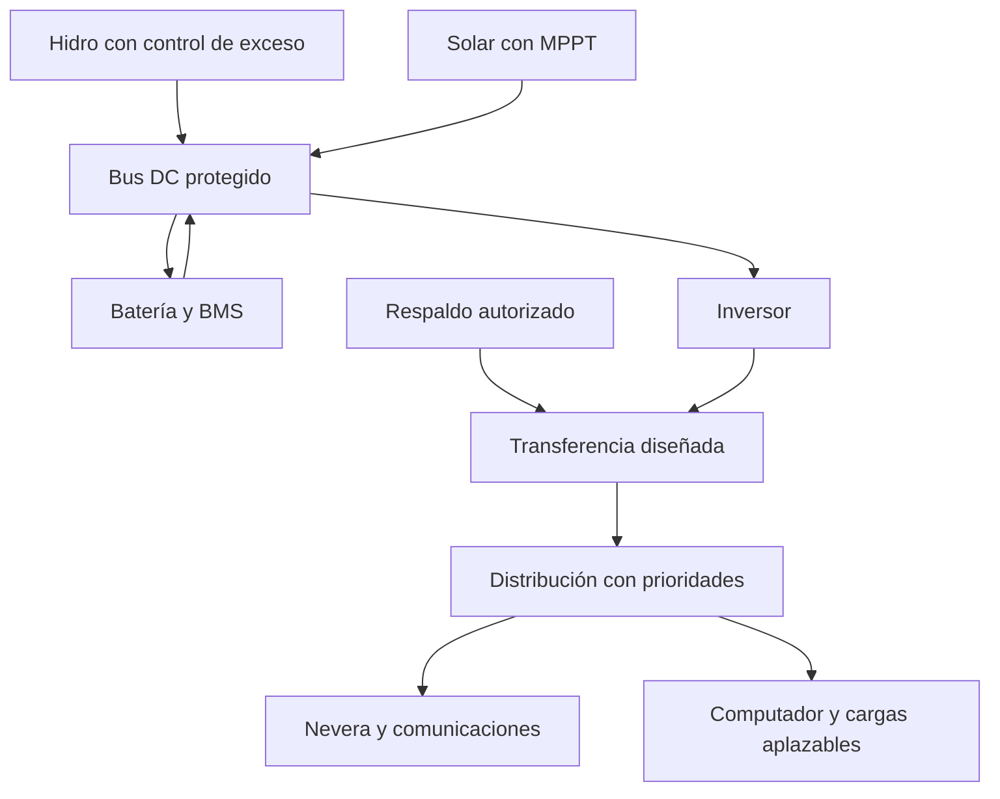

# Escalamiento: cargas esenciales, vivienda y finca

Versión 0.1 • 2026-10-15 • Arquitectura candidata; falta diseño del sitio.

## Arquitectura a evaluar

Microhidráulica como aporte continuo si se confirma el recurso, solar como complemento, almacenamiento para diferencias temporales y un circuito de cargas prioritarias. Mantener la alternativa solar sin hidráulica en la evaluación económica. No comprometerse con el híbrido antes de medir y cotizar.

El diagrama muestra la variante con respaldo y transferencia. Si se omite el respaldo, el diseño de distribución se simplifica según la instalación. No se ponen en paralelo fuentes AC que no estén diseñadas para ello.

## Dimensionamiento básico sin duplicar pérdidas

- **W/kW** expresan potencia; **Wh/kWh**, energía. 100 W continuos durante 24 h son 2,4 kWh.
- Cargas del ejemplo: `E_AC = 2,64 kWh/día`.
- Inversor: eta=0,92 más consumo en vacío separado de 8 W. Control hidráulico: 2 W supuestos, incluso en espera.
- Demanda en bus: `E_bus = 2,64/0,92 + (0,008+0,002)×24 = 3,110 kWh/día`.
- Batería: 4 kWh nominales × 80% de ventana útil × eta descarga 0,96 = **3,072 kWh al bus**, antes del inversor.
- Sin generación: autonomía aproximada `3,072/3,110 = 0,988 días`, unas 23,7 h bajo el perfil supuesto. No son dos días.
- Para dos días sin generación: `C_nominal = 2×3,110/(0,80×0,96) = 8,10 kWh` a batería nueva; si la capacidad ha caído al 80%, serían **10,12 kWh nominales originales** para mantener esa autonomía, sin márgenes adicionales.
- La eficiencia de carga no reduce lo que una batería ya cargada puede entregar; sí incrementa la energía necesaria para recargarla. No incluirla dos veces en autonomía.

En el modelo, límites de potencia: carga al bus 0,6 kW, descarga al bus 1,5 kW e inversor 1,2 kW continuos. Son entradas ilustrativas; la potencia promedio máxima horaria es mucho menor. No validan la capacidad real de arrancar la nevera.

Recargar 3,2 kWh electroquímicos útiles desde reserva con eficiencia 96% exige al menos 3,33 kWh de excedente al bus. Con límite de carga 0,6 kW, hacen falta al menos 5,56 horas de excedente sostenido, además de abastecer cargas. No dividir capacidad solo por potencia nominal del panel.

## Arranques y compatibilidad de componentes

Medir pico de la nevera, duración, tipo de compresor, factor de potencia y simultaneidad. Como ejemplo de verificación, un arranque medido de 900 W durante 2 s más 150 W de otras cargas exigiría que el inversor y batería sostuvieran al menos 1.050 W durante ese intervalo, con tensión dentro de límites; se añade margen por incertidumbre y fabricante. **No se ha medido ese arranque aquí.** W y VA no son intercambiables si el factor de potencia no es uno.

BOM conceptual central del sistema híbrido, cantidades para presupuesto, no lista de compra:

| Elemento | Cantidad | Especificación que falta validar |
|---|---:|---|
| Fuente hidro | 1 conjunto | Curva para Q/H real, eficiencia hasta bus, velocidad y máxima tensión sin carga |
| Conducción | Longitud ilustrativa 100 m | Diámetro interior, presión nominal, transitorios, anclajes, derecho de paso |
| Captación/retorno | 1 conjunto | Caudal permitido, sedimentos, creciente, erosión, fauna y limpieza |
| Paneles | 2 × 400 W como ejemplo | Voc en frío, Isc, área real, sombras y tensión de MPPT; no se fija serie/paralelo |
| MPPT solar | 1 | Tensiones y corrientes admisibles del arreglo, perfil de batería |
| Control hidro y desvío | 1 conjunto dedicado | Compatibilidad con generador, carga máxima de desvío, disipación y modo seguro independiente del BMS |
| Batería | 1 banco comercial de unos 4 kWh para escenario | Química, BMS, corriente pico/continua, temperatura y límites; insuficiente para dos días sin generación |
| Inversor | 1, 1,2 kW solo para simulación | Tensión/frecuencia locales, W/VA y arranque, consumo real a baja carga |
| Protecciones/corte/tierra | 1 conjunto diseñado | Fusibles DC con poder de corte, protecciones AC, diferencial/tierra según esquema, sobretensión y seccionamiento |
| Medición | 1 por frontera clave y 1 contador AC | DC fuente, batería bidireccional, AC útil y consumos auxiliares |
| Respaldo/transferencia | 1 si se acepta | Fuente disponible y mecanismo que impida energizar la red externa accidentalmente |

La integración no consiste en unir salidas de cargadores: deben compartir tensión, límites de carga, perfiles y permisos del fabricante. Baterías grandes siguen siendo de alta energía aunque su tensión sea 12, 24 o 48 V.

## Evidencia de la simulación y qué no establece

11 casos calculados, detalle en [resultados](modelo/salida/resultados.md). El híbrido central cubre 79,2 kWh AC en el período base; conserva igual energía almacenada al inicio/final. El escenario adverso elimina hidro durante los días 12–14 y fija sol en 0,8 HSP/día. Deja **4,16 kWh sin atender en 43 horas**. Batería degradada al 80%: **4,67 kWh**, 50 horas. Batería nominal 8 kWh: todavía **1,46 kWh**, 14 horas.

El programa asigna energía de forma agregada por hora; no modela qué aparato se desconecta ni cómo se conserva temperatura de la nevera. Una hora con déficit es un fallo de servicio potencial aunque se atienda parte de su energía. La fracción de energía atendida no es disponibilidad ni garantía de funcionamiento del compresor.

No se ha estudiado un año real, ni demostrado independencia estadística entre lluvia, caudal y sol. Para diseño se necesitan series concurrentes, meses secos, sucesiones nubladas, averías y crecimiento. Una batería mayor no corrige un déficit energético estacional sostenido.

## Ruta por fases y criterios

Los costos siguientes son **incrementos de planificación** en USD a 2026-10-15. Se sustituyen por cotizaciones; no se suman presupuestos de opciones excluyentes. El valor de reutilización se descuenta solo después de verificar compatibilidad.

| Fase | Objetivo y entregable | Plazo de trabajo/observación | Costo incremental orientativo | Criterio para avanzar |
|---|---|---|---|---|
| 0. Demanda y recursos | Inventario y primeras series de carga/agua; historial y restricciones | 1 semana inicial; seguimiento estacional hasta 12 meses o más | USD 0–150 por instrumentos/préstamos; topografía especializada aparte | Cargas identificadas, primera banda Q/H y plan de estiaje |
| 1. Pruebas básicas | Calor solar y banco pequeño; balance con incertidumbre | 2–6 h de montaje y 3 repeticiones | USD 0–50 en piezas, herramientas existentes aparte | Energía bajo carga reproducible, sin entradas ocultas |
| 2. Prototipo instrumentado | Fuente y carga DC registradas | 2–4 semanas | USD 150–500 adicionales para pequeño módulo; obra hidráulica excluida | Balance explicado, límites térmicos y fallos conocidos |
| 3. Piloto de servicio | Luz/comunicaciones reales; disponibilidad y costo | 30–90 días | USD 300–1.200 adicionales si requiere almacenamiento/carga/control | Servicio definido durante período y eventos ensayados, respaldo disponible |
| 4. Esenciales | Nevera, computador y prioridades con instalación verificada | Diseño/obra según sitio; validación 30–90 días más estación desfavorable | Solar base USD 4.600 o híbrido base USD 8.200, menos componentes anteriores efectivamente reutilizados; contingencias y exclusiones en `06` | Arranques, calidad eléctrica, protecciones, autonomía medida y registro de déficits |
| 5. Vivienda completa | Todas las cargas previamente inventariadas | Medición de temporada de mayor demanda y diseño profesional | Cotización del nuevo alcance menos equipo compatible existente; cifra pendiente de demanda | Cobertura del año histórico y escenarios adversos acordados, respaldo o recorte explícitos |
| 6. Finca | Agua, producción, refrigeración y red de distribución | Un ciclo productivo relevante, con prueba de motores | Incremento por bombas, redes y módulos según Q/H y producción; no cuantificable aún | Servicio productivo conservado, pérdidas y expansión comprobadas |
| 7. Operación | Historial de fallos, repuestos y presupuesto anual | Revisión mensual inicial y anual consolidada | Reservas ilustrativas USD 80/año solar o USD 200/año híbrido, más reposiciones y trabajo | Energía útil y costo reales compatibles con objetivo; ajustar ante degradación |

Fases 5 y 6 quedan **desarrolladas como método**, pero su presupuesto de instalación requiere datos que no existen todavía. No se ofrece una falsa cifra adaptada al sitio.

## Escenarios para entender el salto de escala

Ejemplos **independientes**, sin usar el agua como aporte firme y suponiendo 2,5 HSP, factor FV 0,75, eta batería carga/descarga 0,96, inversor 0,92 y 80% de capacidad útil. Se supone, conservadoramente, que toda la generación pasa por batería para calcular FV. Se usa 0,24 kWh/día de auxiliares para vivienda y 0,528 para finca.

| Alcance hipotético | Consumo AC/día | Bus/día | FV mínimo aritmético | Batería nueva para 2 días sin generación |
|---|---:|---:|---:|---:|
| Esenciales | 2,64 kWh | 3,110 kWh | 1,80 kWp | 8,10 kWh nominales |
| Vivienda completa de ejemplo | 8 kWh | 8,936 kWh | 5,17 kWp | 23,27 kWh nominales |
| Finca de ejemplo | 20 kWh | 22,267 kWh | 12,89 kWp | 57,99 kWh nominales |

Estas cifras muestran por qué cocinar/calentar directamente con sol, programar bombeo y aceptar respaldo puede evitar grandes baterías. No son diseños: faltan picos, restricciones de carga, serie horaria, margen de recarga, envejecimiento y obra. La hidráulica medida puede reducir FV o almacenamiento operativo, pero una parada aún debe cubrirse.

## Distribución y servicio productivo

Para una carga DC de 1 kW a 24 V circulan idealmente 41,7 A; a 48 V, 20,8 A. A igual resistencia, las pérdidas I²R caerían a una cuarta parte, sin incluir diferencias de conversión. Eso explica la importancia de tensión y distancia; no autoriza instalar mayor tensión sin diseño y protección. Registrar caída de tensión bajo arranque de bombas.

Separar prioridades: refrigeración y comunicaciones esenciales; computador según jornada pactada; bombeo y herramientas en ventanas de excedente; calentamiento cuando haya energía o con fuente térmica. No intervenir el termostato de la nevera ni suprimir refrigeración necesaria para perseguir una cifra de autonomía.

## Verificación antes de potencia

Al conocer país/municipio, verificar norma eléctrica vigente y certificaciones, autorización de agua/cauce/obra y límites ambientales, requisitos de estructura y conexión/transferencia de red. No se ha verificado jurisdicción porque no fue indicada. El instalador debe entregar diagrama, cálculos de protección/tierra, compatibilidad, pruebas y manual de operación. Nunca retroalimentar un tomacorriente.

Definir éxito con métricas: energía útil renovable/energía requerida, horas de servicio perdido, energía comprada, horas de trabajo, costo anual y tiempo para recuperar una avería. «Cero factura variable» puede conservar cargos fijos; «cero compras» no equivale a «sin gastos».
